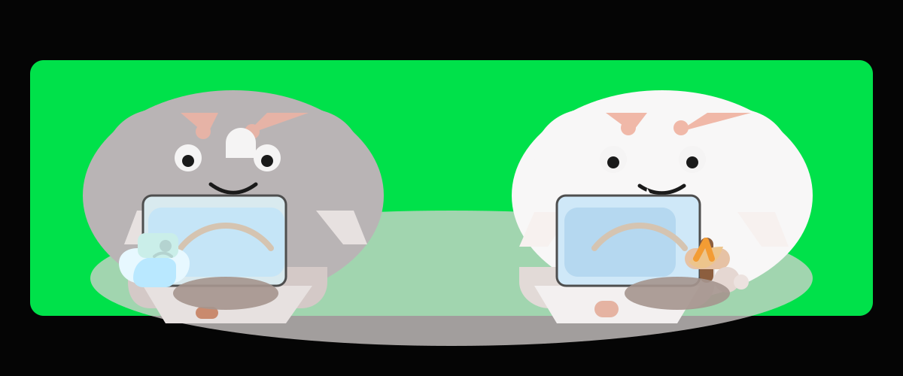

  

   

  <h1>AVA AMIRI</h1>
  <h3>Electrical & Electronics Engineer · Hardware-to-Code Explorer</h3>

  
<i>Turning sparks of curiosity into circuits, firmware, and things that work.</i>

  

    
    
  

---

## `01` — The short circuit

I’m an electrical and electronics engineer drawn to the point where **physical systems meet software**. I like understanding how things work, building small experiments, and improving them one test at a time.

> **Curiosity in. Prototypes out. Lessons learned every time.**

## `02` — What I’m exploring

| Area | On my workbench |
|:--|:--|
| ⚡ **Electronics** | Circuit fundamentals, schematic capture, PCB design, and hardware testing |
| 🤖 **Embedded systems** | STM32 and Arduino microcontrollers, sensors, peripherals, firmware, and control logic |
| 🧩 **Digital design** | VHDL, Verilog, and hardware description fundamentals |
| 💻 **Programming** | C, C++, and Python; debugging and engineering problem-solving |
| 🧪 **Making** | Prototyping, experimentation, iteration, and learning by doing |

## `03` — The toolkit

  
  
  
  
  
  
  
  
  
  

*Schematic → prototype → firmware → test → repeat.*

## `04` — Building blocks

I’m growing my project portfolio through hands-on practice. Here are two places to start:

- **[C — fundamentals & experiments](https://github.com/AvaAmirii/c)** · C-based practice and engineering exercises.
- **[C++ — logic & problem-solving](https://github.com/AvaAmirii/cpp)** · C++ projects and technical learning.

[**Explore all repositories →**](https://github.com/AvaAmirii?tab=repositories)

## `05` — Me & my sister

  

  <strong>Learning, building, and growing together.</strong>

## `06` — Find me

[GitHub · AvaAmirii](https://github.com/AvaAmirii) — the best place to follow what I’m learning and building.

[GitHub · HASTIAMIRI5](https://github.com/HASTIAMIRI5) — my sister’s GitHub, where we share our projects and ideas.

---

  <h3>Signals from the workshop</h3>
  

   
  Built with curiosity, a soldering iron, and a lot of iteration.

